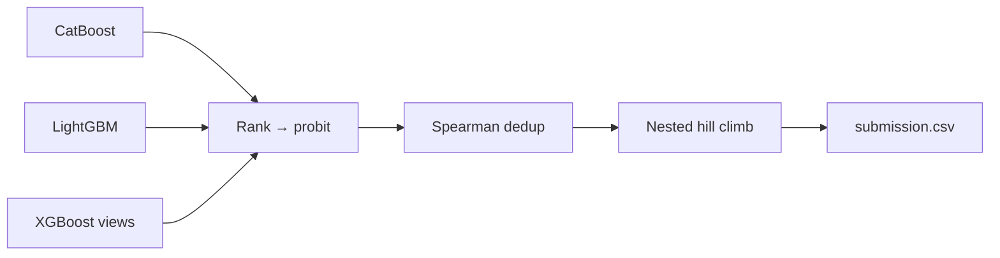

# Kaggle Playground S6E9 — EV Purchase Prediction

**English** | [简体中文](README.zh-CN.md)

My solution notebooks for [Kaggle Playground Series S6E9](https://www.kaggle.com/competitions/playground-series-s6e9). The task is binary classification: predict whether a person will buy an electric vehicle (`Will_Buy_EV`). Submissions are scored by **ROC AUC**.

The project went from a single CatBoost baseline (Public LB **0.94149**) to a multi-model rank ensemble (Public LB **0.94619**), across 17 iterations.

## Data

| File | Rows | Columns |
|---|---:|---|
| `train.csv` | 668,665 | `id`, 13 features, `Will_Buy_EV` (Yes/No) |
| `test.csv` | 286,571 | `id`, 13 features |

Features: `Age`, `Annual_Income_USD`, `Daily_Commute_km`, `Number_of_Cars_Owned`, `Charging_Stations_Near_Home`, `Charging_Stations_Near_Work`, `Environmental_Concern_Level`, `Gender`, `City_Type`, `Current_Car_Type`, `Home_Charging_Possible`, `Subsidy_Available`, `Range_Anxiety_Level`.

The data is not included in this repository (Kaggle's competition rules do not allow redistribution). See [Reproducing](#reproducing) to download it.

## Results

OOF = out-of-fold ROC AUC on the training set. Public LB = the score Kaggle reported on submission. A dash means that score was not recorded.

| # | Notebook | Main change | OOF AUC | Public LB |
|---|---|---|---:|---:|
| 01 | `01_0.94149` | CatBoost 5-fold baseline | 0.94170 | 0.94149 |
| 02 | `02_0.94555` | Digit decomposition + numeric values as categories | — | 0.94555 |
| 03 | `03_0.94570`, `031_0.94570` | 5-fold CatBoost with the validated features | 0.94562 | 0.94570 |
| 04 | `04_reuse_catboost_lightgbm` | Add LightGBM with nested target encoding, 50/50 blend | 0.94599 | 0.94618 |
| 05 | `05_continue_04_lightgbm_blend` | 25/75 blend; LightGBM depth 6 | 0.94602 | 0.94615 |
| 06 | `06_lightgbm_smoothing10` | Target-encoding smoothing 1 → 10 | — | 0.94609 |
| 07 | `07_xgboost_three_model_blend` | Add XGBoost, three-model blend | — | — |
| 08 | `08_conditional_residual_features` | Conditional statistics + residual features | — | — |
| 09 | `09_heuljax_xgb10_rankblend` | 10-fold XGBoost + rank blend | 0.94610 | — |
| 10 | `10_heuljax_logreg_ensemble` | 10-fold logistic regression for model diversity | — | — |
| 11 | `11_probit_nested_stack_rules` | Probit normalization + nested hill climb + OOF stacking | 0.94614 | **0.94619** |
| 12 | `12_strong_xgb_feature_views` | Two stronger XGBoost feature views | 0.94618 | — |
| 13 | `13_realmlp_10fold_v8_nested_hill` | RealMLP (pytabkit) 10-fold | — | — |
| 14 | `14_1_realmlp_pytorch_kaggle_gpu` | RealMLP-style PyTorch for Kaggle GPU | — | — |
| 15 | `15` | RealMLP-style PyTorch on Apple MPS | 0.93902 | — |
| 16 | `16` | XGBoost with window target encoding | 0.94552 | — |
| 17 | `17_final_ensemble` | **Final ensemble** of saved predictions | 0.94617 | — |

## Approach

**Feature engineering**
- **Digit decomposition**: split numeric values such as income into individual digits and trailing 2–3 digits.
- **Numeric values as categories**: add a categorical copy of each numeric feature, so models can pick up signal from exact repeated values.
- **Frequency encoding**, computed only on each fold's training data.
- **Nested target encoding**: an inner K-fold inside each outer training fold, so no row's own label leaks into its encoding.

**Models**
- Gradient-boosted trees: CatBoost, LightGBM, XGBoost (several feature views).
- Logistic regression and RealMLP-style neural networks, added for diversity.

**Ensembling**
- Convert each model's predictions to ranks, then to probit scores.
- Drop near-duplicate models by Spearman correlation.
- Choose blend weights with a nested Caruana hill climb, checked fold by fold.



Final blend weights in notebook 17: LightGBM 1/3; old XGBoost, `strong_rich_te`, `strong_rich_current_rank50` and `v8_views_equal_rank` 1/6 each.

## Repository layout

```
.
├── 01_…ipynb … 17_final_ensemble.ipynb   # experiments, run in numeric order
├── data/          # not included: train.csv, test.csv
└── outputs/       # not included: models, OOF and test predictions (~5.6 GB)
```

## Reproducing

1. Download the data with the [Kaggle CLI](https://github.com/Kaggle/kaggle-api) into `data/`:
   ```bash
   kaggle competitions download -c playground-series-s6e9 -p data
   unzip data/playground-series-s6e9.zip -d data
   ```
2. Install the dependencies:
   ```bash
   pip install numpy pandas scipy scikit-learn catboost lightgbm xgboost torch pytabkit
   ```
3. Each notebook sets `PROJECT = Path("/Users/yw/unsw/Kaggle")`. Change it to your local path.
4. Run the notebooks in numeric order. From 04 onward, each notebook loads saved predictions from earlier runs in `outputs/` instead of retraining, so the earlier notebooks have to be run first.

The notebook comments and explanations are written in Chinese.
