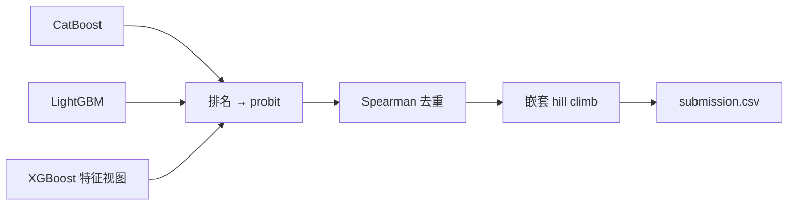

# Kaggle Playground S6E9 — 电动车购买预测

[English](README.md) | **简体中文**

这是我参加 [Kaggle Playground Series S6E9](https://www.kaggle.com/competitions/playground-series-s6e9) 的 notebook。任务是二分类：预测一个人是否会购买电动车（`Will_Buy_EV`），评分指标是 **ROC AUC**。

项目经过 17 轮迭代，从一个 CatBoost baseline（Private LB 0.94091）做到多模型融合（Private LB **0.94526**）。

| 最终成绩 | |
|---|---|
| Private LB | **0.94526** |
| 名次 | **1025 / 3576**（前 29%） |
| 最高 Public LB | 0.94622 |
| 第一名 Private 分数 | 0.94602 |

## 数据

| 文件 | 行数 | 列 |
|---|---:|---|
| `train.csv` | 668,665 | `id`、13 个特征、`Will_Buy_EV`（Yes/No） |
| `test.csv` | 286,571 | `id`、13 个特征 |

特征：`Age`、`Annual_Income_USD`、`Daily_Commute_km`、`Number_of_Cars_Owned`、`Charging_Stations_Near_Home`、`Charging_Stations_Near_Work`、`Environmental_Concern_Level`、`Gender`、`City_Type`、`Current_Car_Type`、`Home_Charging_Possible`、`Subsidy_Available`、`Range_Anxiety_Level`。

仓库里不包含数据（Kaggle 比赛规则不允许再分发）。下载方法见[复现步骤](#复现步骤)。

## 结果

OOF 是训练集上的 out-of-fold ROC AUC。Public LB 和 Private LB 是每次提交后 Kaggle 给出的分数；Private LB 用了约 80% 的测试数据，决定最终排名。OOF 列的“—”表示没有记录这个分数，LB 列的“—”表示这个 notebook 的结果没有提交过。✓ 标记的是最终选去计分的两份提交。

| # | Notebook | 主要改动 | OOF AUC | Public LB | Private LB |
|---|---|---|---:|---:|---:|
| 01 | `01_0.94149` | CatBoost 五折 baseline | 0.94170 | 0.94149 | 0.94091 |
| 02 | `02_0.94555` | 数字拆分 + 数值特征的类别副本 | — | 0.94555 | 0.94470 |
| 03 | `03_0.94570`、`031_0.94570` | 用验证过的特征跑 CatBoost 五折 | 0.94562 | 0.94570 | 0.94486 |
| 04 | `04_reuse_catboost_lightgbm` | 加入 LightGBM（嵌套目标编码），50/50 融合 | 0.94599 | 0.94618 | 0.94525 ✓ |
| 05 | `05_continue_04_lightgbm_blend` | 25/75 融合；LightGBM 深度改为 6 | 0.94602 | 0.94615 | **0.94526** |
| 06 | `06_lightgbm_smoothing10` | 目标编码平滑 1 → 10 | 0.94599 | 0.94609 | 0.94518 |
| 07 | `07_xgboost_three_model_blend` | 加入 XGBoost，三模型融合 | 0.94604 | 0.94612 | 0.94524 |
| 08 | `08_conditional_residual_features` | 条件统计 + 残差特征 | 0.94600 | — | — |
| 09 | `09_heuljax_xgb10_rankblend` | 十折 XGBoost + rank 融合 | 0.94610 | — | — |
| 10 | `10_heuljax_logreg_ensemble` | 十折逻辑回归，增加模型多样性 | 0.94264 ¹ | — | — |
| 11 | `11_probit_nested_stack_rules` | Probit 归一化 + 嵌套 hill climb + OOF stacking | 0.94614 | 0.94619 | 0.94525 |
| 12 | `12_strong_xgb_feature_views` | 两个更强的 XGBoost 特征视图 | 0.94618 | — | — |
| 13 | `13_realmlp_10fold_v8_nested_hill` | RealMLP（pytabkit）十折 | — | — | — |
| 14 | `14_1_realmlp_pytorch_kaggle_gpu` | RealMLP 风格 PyTorch，在 Kaggle GPU 上跑 | — | — | — |
| 15 | `15` | RealMLP 风格 PyTorch，在 Mac MPS 上跑 | 0.93902 | — | — |
| 16 | `16` | XGBoost + 窗口目标编码 | 0.94552 | — | — |
| 17 | `17_final_ensemble` | **最终融合**：对已保存的预测做嵌套 hill climb，再加硬规则 | 0.94618 | **0.94622** | **0.94526** ✓ |

¹ 逻辑回归单模型的分数。所有加入它的融合方案都比 09 的融合分数低。

## 方法

**特征工程**
- **数字拆分**：把收入等数值拆成每一位数字，以及末尾两三位。
- **数值的类别副本**：给每个数值特征加一列类别版本，让模型能学到“重复出现的精确数值”里的信号。
- **频数编码**：只在每一折的训练数据上计算。
- **嵌套目标编码**：在每个外层训练折里再做一层内层 K 折，保证每一行的编码都不会用到它自己的标签。

**模型**
- 梯度提升树：CatBoost、LightGBM、XGBoost（多个特征视图）。
- 逻辑回归和 RealMLP 风格的神经网络，用来增加模型多样性。

**融合**
- 把每个模型的预测转成排名，再转成 probit 分数。
- 按 Spearman 相关系数去掉几乎重复的模型。
- 用嵌套 Caruana hill climb 选择融合权重，并逐折检查。
- 最终提交还加了四条关于数据生成方式的硬规则，来自一个公开 notebook。



notebook 17 的最终权重：LightGBM 占 1/3；old XGBoost、`strong_rich_te`、`strong_rich_current_rank50`、`v8_views_equal_rank` 各占 1/6。

## 经验总结

1. **特征表示带来的提升最大。** 数字拆分加上数值特征的类别副本，让 Public LB 从 0.94149 涨到 0.94555（+0.0041）。之后所有工作加起来只多涨了约 0.0006。
2. **第二种模型只帮上了一次。** 在 CatBoost 之外加入带嵌套目标编码的 LightGBM，Public LB 从 0.94570 涨到 0.94618。之后的提升都非常小。
3. **几个树模型太像了，融合效果有限。** XGBoost 和 CatBoost/LightGBM 融合结果的 Spearman 相关系数达到 0.996，所以再加树模型，OOF 最多只涨约 0.0001。
4. **OOF 上的小提升到了榜上不一定成立。** 05 的 25/75 融合在 5 折上 OOF 都提高了（0.94599 → 0.94602），Public LB 却下降了（0.94618 → 0.94615），Private LB 又上升了（0.94525 → 0.94526）。同一份 OOF 既用来早停又用来挑选方案，所以它偏乐观。小于 0.0001 左右的差异基本是噪声，往哪个方向变都有可能。
5. **换一种模型，只有它本身够强才有用。** 逻辑回归（0.94264）和 RealMLP 风格的神经网络（0.93902）都太弱。所有加入逻辑回归的融合方案都比 09 的融合低 0.0004–0.0009。
6. **元融合在 OOF 和 Public 上有用，在 Private 上没有。** 用 probit 归一化排名加嵌套 hill climb，OOF 从 0.94610 涨到 0.94618，也拿到了最高的两个 Public LB（11 的 0.94619、17 的 0.94622）。但在 Private LB 上，最终融合和 05 的简单 25/75 融合打平，都是 0.94526。
7. **瓶颈在单模型实力，不在融合方法。** 我最好的单个 XGBoost 只有 0.94600 OOF，而这个比赛的公开分享里，十折 XGBoost 的 CV 能到 0.9462–0.9465。先把这个差距补上，比继续调融合更重要。
8. **固定折划分并保存预测，省了大量时间。** 所有模型都用同一个五折划分（`StratifiedKFold`，seed 42），并保存 OOF 和测试集预测。后面的 notebook 直接读取这些结果，不用重新训练，融合前也会先核对 ID 和折划分是否一致。
9. **最终成绩在 notebook 04 时就基本定了。** 01–04 让 Private LB 从 0.94091 涨到 0.94525，之后的 13 个 notebook 只让它变了 0.00001。第一名（0.94602）比我高 0.00076，这个差距靠调融合补不上。

## 目录结构

```
.
├── 01_…ipynb … 17_final_ensemble.ipynb   # 实验 notebook，按编号顺序运行
├── data/          # 未上传：train.csv、test.csv
└── outputs/       # 未上传：模型、OOF 和测试集预测（约 5.6 GB）
```

## 复现步骤

1. 用 [Kaggle CLI](https://github.com/Kaggle/kaggle-api) 把数据下载到 `data/`：
   ```bash
   kaggle competitions download -c playground-series-s6e9 -p data
   unzip data/playground-series-s6e9.zip -d data
   ```
2. 安装依赖（Python 3.11，具体版本见 [requirements.txt](requirements.txt)）：
   ```bash
   pip install -r requirements.txt
   ```
3. 每个 notebook 里都写死了 `PROJECT = Path("/Users/yw/unsw/Kaggle")`，改成你自己的路径。
4. 按编号顺序运行。从 04 开始，notebook 会读取 `outputs/` 里之前保存的预测结果，而不是重新训练，所以必须先跑前面的 notebook。
