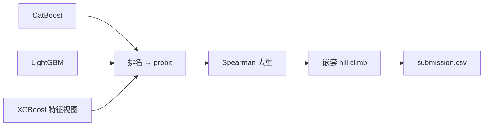

# Kaggle Playground S6E9 — 电动车购买预测

[English](README.md) | **简体中文**

这是我参加 [Kaggle Playground Series S6E9](https://www.kaggle.com/competitions/playground-series-s6e9) 的 notebook。任务是二分类：预测一个人是否会购买电动车（`Will_Buy_EV`），评分指标是 **ROC AUC**。

项目经过 17 轮迭代，从一个 CatBoost baseline（Public LB **0.94149**）做到多模型 rank 融合（Public LB **0.94619**）。

## 数据

| 文件 | 行数 | 列 |
|---|---:|---|
| `train.csv` | 668,665 | `id`、13 个特征、`Will_Buy_EV`（Yes/No） |
| `test.csv` | 286,571 | `id`、13 个特征 |

特征：`Age`、`Annual_Income_USD`、`Daily_Commute_km`、`Number_of_Cars_Owned`、`Charging_Stations_Near_Home`、`Charging_Stations_Near_Work`、`Environmental_Concern_Level`、`Gender`、`City_Type`、`Current_Car_Type`、`Home_Charging_Possible`、`Subsidy_Available`、`Range_Anxiety_Level`。

仓库里不包含数据（Kaggle 比赛规则不允许再分发）。下载方法见[复现步骤](#复现步骤)。

## 结果

OOF 是训练集上的 out-of-fold ROC AUC，Public LB 是提交后 Kaggle 给出的分数。“—”表示没有记录这个分数。

| # | Notebook | 主要改动 | OOF AUC | Public LB |
|---|---|---|---:|---:|
| 01 | `01_0.94149` | CatBoost 五折 baseline | 0.94170 | 0.94149 |
| 02 | `02_0.94555` | 数字拆分 + 数值特征的类别副本 | — | 0.94555 |
| 03 | `03_0.94570`、`031_0.94570` | 用验证过的特征跑 CatBoost 五折 | 0.94562 | 0.94570 |
| 04 | `04_reuse_catboost_lightgbm` | 加入 LightGBM（嵌套目标编码），50/50 融合 | 0.94599 | 0.94618 |
| 05 | `05_continue_04_lightgbm_blend` | 25/75 融合；LightGBM 深度改为 6 | 0.94602 | 0.94615 |
| 06 | `06_lightgbm_smoothing10` | 目标编码平滑 1 → 10 | — | 0.94609 |
| 07 | `07_xgboost_three_model_blend` | 加入 XGBoost，三模型融合 | — | — |
| 08 | `08_conditional_residual_features` | 条件统计 + 残差特征 | — | — |
| 09 | `09_heuljax_xgb10_rankblend` | 十折 XGBoost + rank 融合 | 0.94610 | — |
| 10 | `10_heuljax_logreg_ensemble` | 十折逻辑回归，增加模型多样性 | — | — |
| 11 | `11_probit_nested_stack_rules` | Probit 归一化 + 嵌套 hill climb + OOF stacking | 0.94614 | **0.94619** |
| 12 | `12_strong_xgb_feature_views` | 两个更强的 XGBoost 特征视图 | 0.94618 | — |
| 13 | `13_realmlp_10fold_v8_nested_hill` | RealMLP（pytabkit）十折 | — | — |
| 14 | `14_1_realmlp_pytorch_kaggle_gpu` | RealMLP 风格 PyTorch，在 Kaggle GPU 上跑 | — | — |
| 15 | `15` | RealMLP 风格 PyTorch，在 Mac MPS 上跑 | 0.93902 | — |
| 16 | `16` | XGBoost + 窗口目标编码 | 0.94552 | — |
| 17 | `17_final_ensemble` | 用已保存的预测做**最终融合** | 0.94617 | — |

## 方法

**特征工程**
- **数字拆分**：把收入等数值拆成每一位数字，以及末尾两三位。
- **数值的类别副本**：给每个数值特征加一列类别版本，让模型能学到“重复出现的精确数值”里的信号。
- **频数编码**：只在每一折的训练数据上计算。
- **嵌套目标编码**：在每个外层训练折里再做一层内层 K 折，保证每一行的编码都不会用到它自己的标签。

**模型**
- 梯度提升树：CatBoost、LightGBM、XGBoost（多个特征视图）。
- 逻辑回归和 RealMLP 风格的神经网络，用来增加模型多样性。

**融合**
- 把每个模型的预测转成排名，再转成 probit 分数。
- 按 Spearman 相关系数去掉几乎重复的模型。
- 用嵌套 Caruana hill climb 选择融合权重，并逐折检查。



notebook 17 的最终权重：LightGBM 占 1/3；old XGBoost、`strong_rich_te`、`strong_rich_current_rank50`、`v8_views_equal_rank` 各占 1/6。

## 目录结构

```
.
├── 01_…ipynb … 17_final_ensemble.ipynb   # 实验 notebook，按编号顺序运行
├── data/          # 未上传：train.csv、test.csv
└── outputs/       # 未上传：模型、OOF 和测试集预测（约 5.6 GB）
```

## 复现步骤

1. 用 [Kaggle CLI](https://github.com/Kaggle/kaggle-api) 把数据下载到 `data/`：
   ```bash
   kaggle competitions download -c playground-series-s6e9 -p data
   unzip data/playground-series-s6e9.zip -d data
   ```
2. 安装依赖：
   ```bash
   pip install numpy pandas scipy scikit-learn catboost lightgbm xgboost torch pytabkit
   ```
3. 每个 notebook 里都写死了 `PROJECT = Path("/Users/yw/unsw/Kaggle")`，改成你自己的路径。
4. 按编号顺序运行。从 04 开始，notebook 会读取 `outputs/` 里之前保存的预测结果，而不是重新训练，所以必须先跑前面的 notebook。
